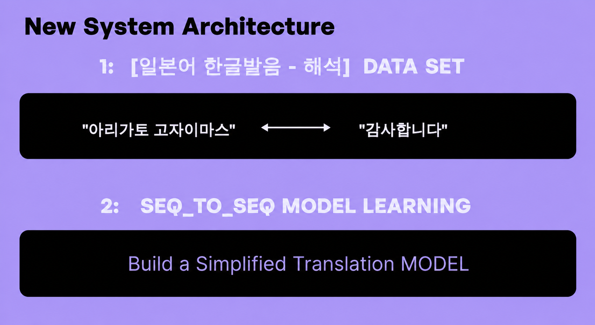
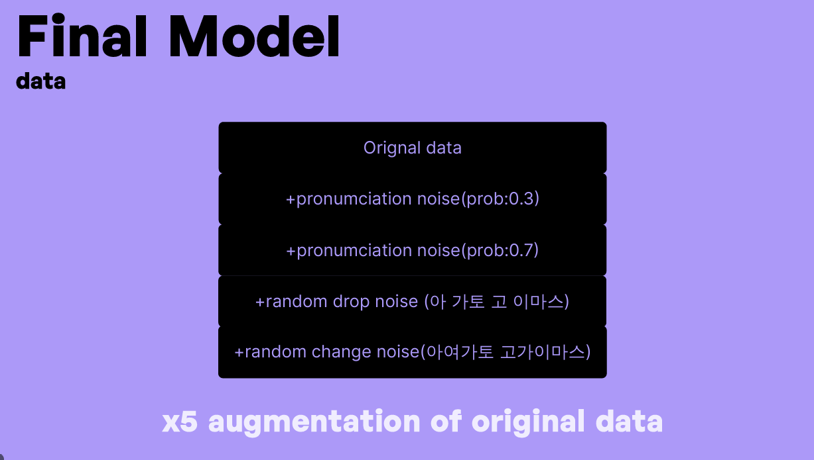
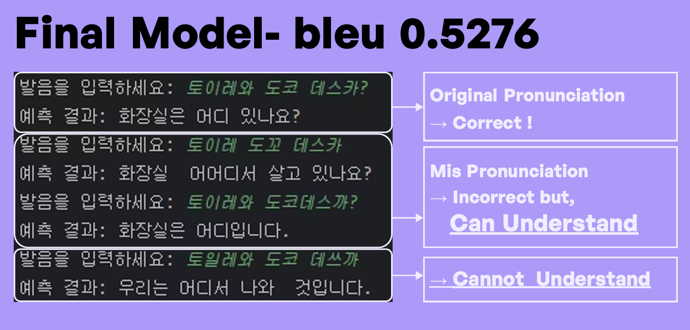

# PhonoTrans | Japanese Pronunciation-Based Translator

**Character-level Seq2Seq with GRU and Attention · 2025**


PhonoTrans translates **Japanese pronunciation written in Hangul directly into Korean**, without requiring users to type Japanese characters. It replaces an error-prone multi-stage translation pipeline with a character-level Seq2Seq model.

**Reported final result:** BLEU **0.5276** (mean character-level sentence BLEU; historical presentation result, not reproduced from the public repository).

## Project Overview

- **Period:** 2025
- **Task:** Sequence-to-sequence translation
- **Input:** Japanese pronunciation written in Hangul
- **Output:** Korean sentence
- **Model:** Character-level Seq2Seq with GRU encoder-decoder and Attention
- **Framework:** PyTorch
- **Evaluation:** BLEU

## Data

### Pipeline Redesign

The original approach translated through multiple intermediate representations:

`Hangul pronunciation → Romanization → Japanese text → Korean translation`


Errors could propagate across stages, motivating a direct Hangul-pronunciation-to-Korean mapping.



The project combined a general Japanese corpus with dialogue-focused data.

| Data source | Size |
| --- | ---: |
| General Japanese corpus | 203,821 sentences |
| Dialogue / conversational corpus | 41,736 sentences |
| Combined scale | approximately 245K sentence pairs |

Japanese sentences were converted into training pairs containing Hangul pronunciation and Korean meaning. For the dialogue corpus, the recovered project code extracts utterances from dialogue JSON and collects Papago pronunciation and Korean translation through Selenium.

Recovered scripts document two data-splitting workflows: an **80/10/10** train/validation/test split (seed 42), and a later workflow that reserved **10% for testing** before augmenting and re-splitting the remaining data. The repository includes only sample data, not the complete externally collected corpus.

### Data Augmentation Experiments

The project compared pronunciation-noise strengths **0.3, 0.5, 0.7, and 1.0**, as well as random Hangul substitution and random drop at **0.2**.

The final presentation setup combined pronunciation noise at **0.3 and 0.7** with substitution and drop, expanding the training data approximately **fivefold**.



Some recorded runs reached BLEU around **0.56**, but their evaluation settings are incomplete and are not directly comparable. Public utilities cover pronunciation noise and the **0.3 dual-noise** workflow; the full fivefold augmentation recipe is not included.

## Approach

### Model Architecture

The final model is a character-level Seq2Seq architecture with three main components:

1. **Encoder** — character embedding + GRU
2. **Attention** — computes attention weights over encoder outputs at each decoding step
3. **Decoder** — character embedding + attention context + GRU + linear output layer

Training uses teacher forcing, validation/evaluation uses greedy token selection, and interactive inference uses autoregressive greedy decoding.

## Results

The final presentation model reported **BLEU 0.5276**. Qualitative inference examples showed correct output for the original pronunciation and partial tolerance to some pronunciation variations, while stronger distortions could still lead to unrelated predictions.



## Repository Structure

```text
phonotrans/
├── README.md
├── requirements.txt
├── .gitignore
├── docs/
│   └── images/
│       ├── original_architecture.png
│       ├── new_architecture.png
│       ├── final_model_data.png
│       └── final_model_result.png
├── data/
│   └── sample.csv
├── data_collection/
│   └── dialogue_papago.py
├── preprocessing/
│   ├── pronunciation_converter.py
│   ├── split_dataset.py
│   ├── noise_generator.py
│   └── augmentation.py
├── experiments/
│   └── initial_pipeline/
│       ├── hangul_to_romanization.py
│       ├── romaji_to_hiragana.py
│       ├── jp_to_ko_mbart.py
│       └── pipeline_demo.py
└── src/
    ├── config.py
    ├── data.py
    ├── model_factory.py
    ├── seq2seq.py
    ├── utils.py
    ├── train.py
    ├── eval.py
    └── infer.py
```

## Usage

### Example

```text
Input : 혼와 도코데 카에마스카
Target: 책은 어디서 살 수 있나요?
```

Run the commands from the repository root in a Python environment with a compatible PyTorch installation.

```bash
pip install -r requirements.txt
```

`data/sample.csv` illustrates the required input format; full training and evaluation datasets are not included.

### Data Preparation

After preparing the source CSV, the recovered preprocessing commands are:

```bash
python preprocessing/split_dataset.py --input data/final_converted_input_target.csv --output-dir data
python preprocessing/augmentation.py --input data/dataset_except_test.csv --prob 0.3 --output-dir data
```

The second command assumes the test partition has already been excluded; these scripts do not reproduce the full later fivefold augmentation recipe.

### Training

Place prepared `train.csv`, `val.csv`, and `test.csv` files under `data/` with the following columns:

```text
input,target
```

The settings in `src/config.py` follow the presentation setup: batch size **64** (validation **16**), embedding **128**, hidden size **256**, up to **30 epochs**, learning rate **0.001**, teacher forcing **0.6**, early-stopping patience **5**, and weight decay **0.0001**.

Training:

```bash
python src/train.py
```

Evaluation:

```bash
python src/eval.py
```

Evaluation and inference require the model checkpoint and character vocabularies generated by training under `runs/`; these artifacts are not provided in the public repository.

Interactive inference:

```bash
python src/infer.py
```

## Limitations

- Evaluation reports the **mean of character-level sentence BLEU scores**, using NLTK smoothing method 1. It is not a corpus-level word-tokenized BLEU score.
- The evaluation script decodes for the reference target's length, whereas interactive inference stops at EOS or 100 generated characters. Their decoding conditions differ.
- The recovered augmentation utility merges original and augmented rows before splitting train/validation data. Variants of the same source sentence may therefore appear in both sets, which can make validation optimistic. Future experiments should split source examples before augmenting the training set.
- The full corpus, original final checkpoint, and complete fivefold augmentation recipe are absent, so the reported **0.5276** is a historical project result rather than a score reproduced by this public repository.
- Strong pronunciation distortions can produce unrelated translations. Evaluation on realistic user transcriptions remains future work.

## Review

This project demonstrates a redesign from a multi-stage translation pipeline to direct sequence-to-sequence modeling. The augmentation experiments also illustrate the challenges of evaluating robustness to imperfect phonetic transcriptions.

## Tech Stack

`Python` `PyTorch` `Pandas` `NLTK` `scikit-learn` `Selenium` `Seq2Seq` `GRU` `Attention` `NLP` `Data Augmentation`

## Data and Third-party Resources

- **Data:** Japanese general and dialogue corpora were processed into Hangul-pronunciation/Korean-meaning pairs; full source corpora and final weights are not redistributed. Original corpus names and redistribution rights were not established from the available repository materials.
- **External services / models:** Papago collection via Selenium and pretrained components used in the early translation experiments are third-party services or models, subject to their own terms.

Dependency lists are in `requirements.txt`; unless versions are explicitly pinned there, they do not reproduce an exact historical software environment. No redistribution permission for third-party inputs is implied by this repository.
